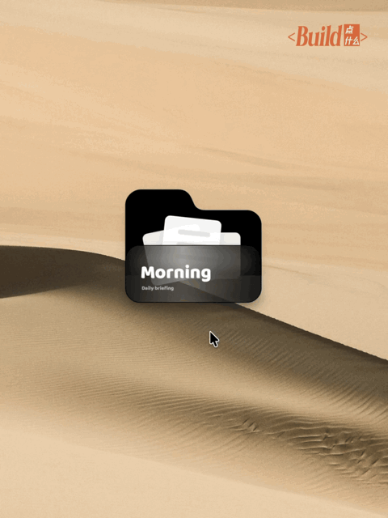
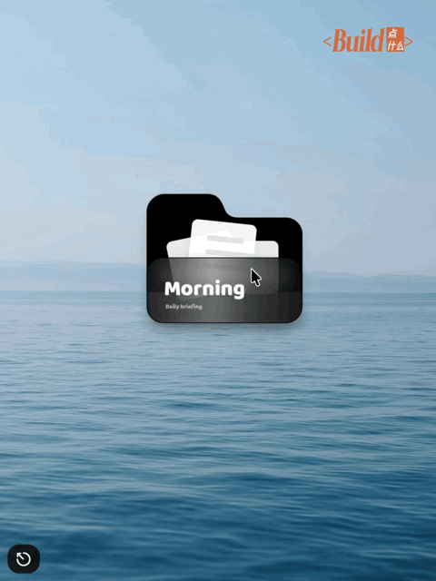
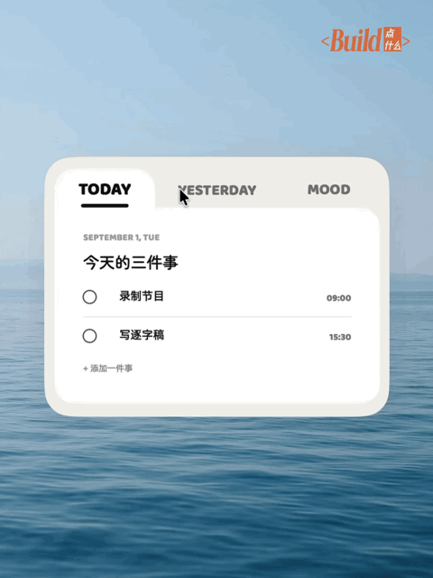
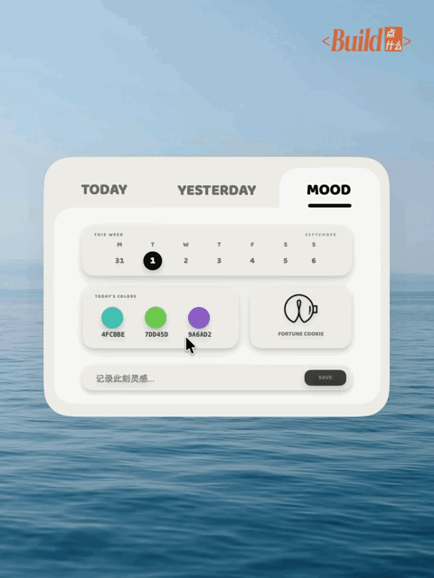

<div align="center">

# Morning

**把今天的三件事、昨天的回声，和此刻的灵感，装进桌面上的小文件夹。**

一款用 SwiftUI 与 AppKit 构建的 macOS 桌面晨报应用。

[下载 Morning 0.1.0](https://github.com/JamieBai10/Morning/raw/refs/tags/v0.1.0/Morning-macOS.zip) · [版本说明](https://github.com/JamieBai10/Morning/releases/tag/v0.1.0) · [反馈问题](https://github.com/JamieBai10/Morning/issues)

macOS 14+ · Apple 芯片 · 源码 MIT



</div>

## 从一个小文件夹，开始新的一天

打开电脑，先想想今天最想完成哪三件事。

Morning 平时是桌面上一个可移动的小文件夹。点击展开，就能安排今天、回看昨天，也能随手收下一个突然冒出来的念头。纸张、圆角卡片和轻巧的动效，让每天打开它成为一个小小的仪式。

| Today · 今天的三件事 | Yesterday · 昨日回声 | Mood · 给今天一点颜色 |
| :--- | :--- | :--- |
| 写下重点，设定时间，完成后打勾 | 回顾任务与日程，看看昨天做了什么 | 每日配色、幸运饼干和灵感速记 |

## Today：给今天留三个位置

每天最多记录三件事，把最想完成的事情放在眼前。

- **写下任务**：点击添加，输入今天的重点。
- **安排时间**：为任务设置时间，方便一眼查看。
- **标记完成**：做完一件，就勾掉一件。
- **随时调整**：清空任务文字后点击空白处，即可删除任务。

<p align="center">
  
</p>

## Yesterday：看看昨天留下了什么

昨天做了哪些事，时间花在了哪里？打开「昨日回声」，回顾已完成任务、日历日程、灵感和提醒事项。

带有具体时长的日程会显示标题与时长。当前回顾使用本地规则生成；展示的时间来自日程数据。

<p align="center">
  
</p>

支持读取**苹果日历**；也可以额外连接**飞书主日历**。飞书连接需要安装并授权飞书 CLI，具体见[飞书日历连接指南](Distribution/飞书日历连接指南.txt)。

## Mood：给今天一点颜色，也留住一个念头

看看本周的日期，收下今天的随机配色，再打开一块幸运饼干。

- **每日色盘**：每天一组颜色，点击色值即可复制。
- **幸运饼干**：打开看看今天的一句话。
- **灵感速记**：把此刻想到的内容写下来，先保存到本地。
- **笔记去向**：根据设置，将速记写入 Apple Notes 或指定的 Obsidian Markdown 文件。

<p align="center">
  
</p>

## 下载与安装

**[下载 Morning 0.1.0（macOS 安装包）](https://github.com/JamieBai10/Morning/raw/refs/tags/v0.1.0/Morning-macOS.zip)**

| 项目 | 要求 |
| :--- | :--- |
| 芯片 | Apple 芯片 Mac（M 系列）；Intel Mac 暂不支持 |
| 系统 | 最低 macOS 14；尚未逐一实机验证所有系统版本 |
| 当前版本 | 0.1.0 |
| 签名状态 | 当前安装包尚未经 Apple 公证 |

1. 下载并解压 ZIP，将 `Morning.app` 拖入「应用程序」。
2. 打开 Morning。如果 macOS 阻止启动，请在确认来源可信后，前往「系统设置 → 隐私与安全性」选择「仍要打开」。
3. 按需要授权日历、提醒事项或备忘录等功能，开始填写今天的三件事。

详细步骤见[安装与首次打开指南](Distribution/安装前请先阅读.txt)。安装包内也提供 `Read-Me-First.txt` 和 `Feishu-Calendar-Guide.txt`。

飞书日历为可选功能，尚不支持飞书共享或订阅日历。尚未配置飞书时，也可以使用其他功能。

## 数据与隐私

任务、灵感、每日颜色和昨日回声缓存保存在本机：

```text
~/Library/Application Support/MorningFolder/
```

系统权限会在相应功能需要时请求。昨日回声当前使用本地规则生成；飞书日历读取依赖你配置的飞书 CLI 和网络。速记会先保存到本地，再按设置写入外部笔记。

开发时请勿将 `.env.local`、API 密钥、个人数据或本机缓存提交到仓库。

## 本地开发

项目使用 **Swift Package Manager + SwiftUI + AppKit**。需要 macOS、Swift 5.10 或更新版本，以及兼容的 Apple 开发工具和 macOS SDK。

```bash
git clone https://github.com/JamieBai10/Morning.git
cd Morning

# 编译
swift build

# 构建并运行 macOS App
./script/build_and_run.sh

# 打包分发
./script/build_and_run.sh --archive
```

打包产物为 `dist/Morning-macOS.zip`。脚本默认使用临时签名，不等同于 Developer ID 签名或 Apple 公证；不同开发工具版本可能需要调整工具链和 SDK。

## 反馈与贡献

欢迎通过 [Issues](https://github.com/JamieBai10/Morning/issues) 反馈问题或提出建议，也欢迎提交 Pull Request。反馈时请附上 macOS 版本、芯片型号、复现步骤和必要的截图。

目前已在 Apple 芯片 Mac 上运行，并由用户在另一台 Mac 上完成安装和功能测试。不同 macOS 版本及权限组合仍待进一步验证。

## 贡献和许可

源码采用 [MIT License](LICENSE)，允许按该许可证使用，包括商业用途。以下素材不因源码采用 MIT 许可证而自动获得相同授权：

- **原创图片**：项目作者创作的图片允许他人出于非商业目的复制、修改和分发；商业使用需另行取得作者许可。此授权仅适用于作者有权授权的原创图片。
- **字体**：项目使用的字体包括 AlibabaPuHuiTi-3-65-Medium、Baloo2 和 jyhphy-2。项目作者表示这些字体可以商用；但字体文件的复制、修改、打包和再分发应遵循各自的字体许可，相关许可文件及具体条件尚待核实。请勿仅凭“可商用”认定可以自由再分发字体文件。
- **幸运饼干文案**：由项目作者原创，允许他人出于非商业目的复制、修改和分发；商业使用需另行取得作者许可。

